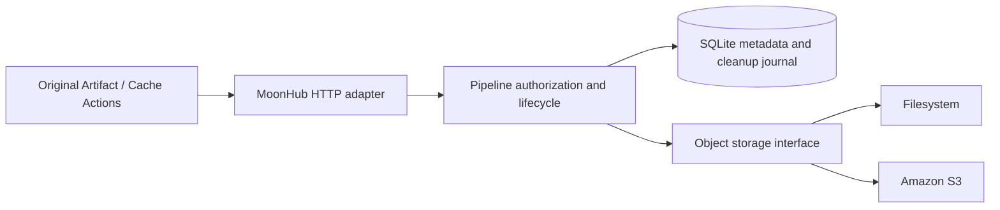

# Artifact and cache storage

Artifacts and CI caches use a common object storage boundary. Deployments can
select filesystem (`fs`) or Amazon S3 (`s3`) independently for each kind. Without
configuration, both retain the historical repository-root filesystem layout.
Git repositories, SQLite, issue attachments and container images are unchanged.

## Responsibilities

The `storage` package has no database, repository, Pipeline or Web dependencies.
It owns immutable object writes, ordered composition, bounded streaming readers,
integrity checks and idempotent removal. `pipeline` owns object identities,
repository authorization, runtime capabilities, immutable cache reservations,
quotas, retention and cleanup intents. Web adapts a scoped reader to HTTP and
rechecks authorization before each emitted chunk. No storage path or S3 URL is
returned to clients, and runners receive no S3 credentials.



The S3 adapter uses the pinned AWS SDK for JavaScript in a server-only subprocess.
The SDK handles request signing, deployment credential providers and retries.
Requests enter over stdin; downloads leave over a pipe with backpressure. The
process and its streams are scoped to each operation and have a ten-minute
deadline. Provider diagnostics are not reflected into HTTP responses or logs.
This adapter is independent of downloaded Actions and their runtime dependencies.

## Configuration

Set `MOONHUB_STORAGE_CONFIG` to a JSON file readable by the Web service. Use
[the example](../deploy/storage.example.json) as a starting point:

```json
{
  "artifacts": "remote",
  "caches": "remote",
  "backends": {
    "local": { "type": "fs", "root": "/data/repos/.pipeline-artifacts" },
    "remote": {
      "type": "s3",
      "bucket": "moonhub-private-blobs",
      "region": "us-west-2",
      "prefix": "production/blobs"
    }
  }
}
```

The two top-level selections refer to backend names; choose `local` for either
one to keep that kind on disk. Unknown fields, missing selections, invalid paths
and credential fields are rejected. Filesystem roots must be absolute. In Docker,
keep them under `/data` if they should be included in the data-volume backup.

S3 accepts optional `endpoint` and `force_path_style` settings for compatible
services. Endpoints require HTTPS; HTTP is accepted only for explicit
`127.0.0.1:PORT` integration fixtures. Bucket/key prefix configuration contains no
credentials. The SDK uses the Web process's default AWS credential provider chain,
including instance/task roles. Verify that credentials and any instance metadata
endpoint are accessible from the Web container. Keep credentials out of job
environments, configuration files and command arguments.

The deployment must allow the selected bucket/prefix operations: object GET,
PUT, DELETE, object listing, multipart creation/upload/completion/abort and
listing incomplete uploads. Use a private, dedicated prefix. Use S3 Standard in
the runner's Region initially. Do not enable object versioning or Object Lock for
this prefix: the current cleanup adapter removes current objects and does not
purge historical object versions or bypass retention locks.

For the tracked Compose deployment, set an absolute host path in
`MOONHUB_STORAGE_CONFIG_FILE`; `deploy/deploy.sh` automatically adds the Web-only,
read-only [storage overlay](../deploy/compose.storage.yaml). The host file and SDK bridge are
validated offline with `moonhub storage-check` before the service switch and included in recovery backups. For a
custom Compose invocation, include that overlay explicitly. The image installs
the SDK bridge; local development needs `npm ci --prefix storage/s3 --ignore-scripts`.
`MOONHUB_STORAGE_NODE` and `MOONHUB_S3_HELPER` can override the server executable
and bridge path. Startup checks the selected configuration and bridge; remote
bucket permissions must also be verified with an acceptance run.

For a Web container that cannot reach instance metadata, set
`MOONHUB_STORAGE_AWS_DIR` to a protected host directory containing the SDK's
`config` and optional `credentials` files. The tracked deployment adds a
read-only mount to Web only and disables instance metadata discovery there.
An operator-managed credential process can return scoped temporary role
credentials with expiration; rotate its data atomically inside the mounted
directory. Keep the directory writable only by the host identity refresher and
readable by the Web UID. Never mount it into SSH, providers or task containers.
Backups include this private mount; recovered temporary credentials still need
a running refresher and must not be mistaken for a renewable identity.

## Uploads, integrity and resource use

The existing Artifact/Cache v4 RPCs and Azure-style blob operations remain the
client contract. Each staged block gets a random immutable storage key. Its
recorded length and SHA-256 are checked again during composition. A new archive
generation becomes visible only after composition and business finalization
succeed. Block replacement and HTTP retries preserve the existing semantics.

On S3, staged blocks are separate remote objects. Composition reads the selected
blocks in their requested order and repacks them into 8 MiB multipart uploads;
arbitrarily small blocks do not become invalid non-final S3 parts. SHA-256 is
computed over the complete ordered stream, independently of multipart ETags.
There is no full-archive disk spool or local retained replica. Downloads likewise
stream from S3 with bounded buffers. Existing HTTP upload buffers are unchanged:
up to 128 MiB for one cache block and four admitted blob transfers per Web process.
The SDK bridge currently buffers one upload block as well, so budget an additional
128 MiB per concurrent cache upload subprocess. Archive composition uses an 8 MiB
output part plus stream buffers, rather than the complete archive.

Staged blocks and assembled archives still coexist remotely until cleanup.
Account for that overhead when budgeting S3 storage. The fs backend continues to
have the equivalent local disk overhead. Measure transfer time, memory, disk and
request volume with realistic archives before production cutover.

## Cutover, rollback and cleanup

Migration 039 adds storage locations and a durable deletion journal. Historical
records without a location continue to read from `.pipeline-artifacts` under the
repository root. New records capture their complete destination descriptor,
including the filesystem root or S3 bucket/Region/prefix. Editing the default
selection only affects newly reserved artifacts and caches; pending uploads,
historical downloads and cleanup retain their original destinations.

For an incremental cutover:

1. Deploy the schema and both adapters with the default fs configuration.
2. Provision a private bucket/prefix, credentials and incomplete-upload lifecycle
   cleanup, and verify S3 access from the Web service.
3. Change the defaults to S3, restart through the normal deployment path, and run
   original upload/download and cache save/restore acceptance workflows.
4. Verify old fs artifacts and caches remain readable, then allow their normal
   retention/eviction to reclaim local space. Existing data is not automatically
   copied. Do not delete or relocate the old fs root while metadata still refers
   to it. Bulk migration requires a separate verified copy-and-metadata procedure.

Rollback the backend selection by choosing fs again while keeping this version
of the storage-aware service: existing S3 objects stay readable through their
saved locations. A pre-migration binary cannot open the newer schema. Binary
rollback requires the matching database/data backup and the normal recovery
procedure; do not reinterpret S3 records as local paths.

Every external write has a deletion intent before I/O begins. Linking a staged
block or completed archive and removing that intent happen atomically. A crash
therefore leaves recoverable work rather than an untracked object. Run/repository
cascade deletion records a namespace deletion intent independent of foreign keys.
Normal cascade cleanup waits ten minutes for in-flight transfers. Permanent
repository deletion also performs an initial cleanup at the saved destinations
and retains this delayed intent to reclaim uploads that finish afterwards.

The existing cleanup worker reclaims expired/deleted records and retries due
deletion intents. Successful remote deletion precedes metadata reclamation;
failure leaves tombstones or intents for retry. Failed work is deferred for at
least one minute and moves behind older untried work, so a full failed batch
cannot starve healthy destinations in later sweeps. Namespace cleanup removes staged
objects, assembled archives and unfinished multipart uploads. Configure the
bucket to abort incomplete multipart uploads after one day as an additional
crash safeguard. Do not apply a fixed-age expiry to finalized cache objects:
MoonHub extends cache retention on lookup, which an S3 object-age rule does not
track. Cache LRU, scope and logical quotas remain in Pipeline.

## Backups and verification

Data-volume backups retain SQLite and fs data under `/data`; they do not copy S3
objects or filesystem roots outside that volume. The storage configuration mount
is backed up, but role credentials and remote object recovery need deployment
procedures. Restoring a database backup also requires its referenced blobs to
still exist. Coordinate artifact retention/backup policy with the database's
recovery window. Caches may be rebuilt; published artifacts may require separate
remote protection. Backend errors never silently switch new writes to fs.

Run the fs, cutover, migration and fault regressions with:

```sh
moon test --strip -j 1 storage pipeline database web/views/pipelines
node --test storage/s3/backend.test.mjs
node scripts/check-package-boundaries.cjs
```

`node scripts/storage-s3-smoke.mjs` starts a disposable localhost-only S3Mock service,
exercises both storage contracts and the unchanged upstream Artifact/Cache v4
Actions against S3, and removes the container and its data afterward. The same
test runs in Self-check. It requires Docker, installed storage/action npm
dependencies and the pinned MoonBit toolchain. No production AWS resources are
created by that test.

Published release assets use the same storage adapters with their own durable lifecycle and no CI retention expiry. The optional `releases` backend selector defaults to `artifacts`; saved asset locations survive changes. See [Release storage and recovery](releases.md).
